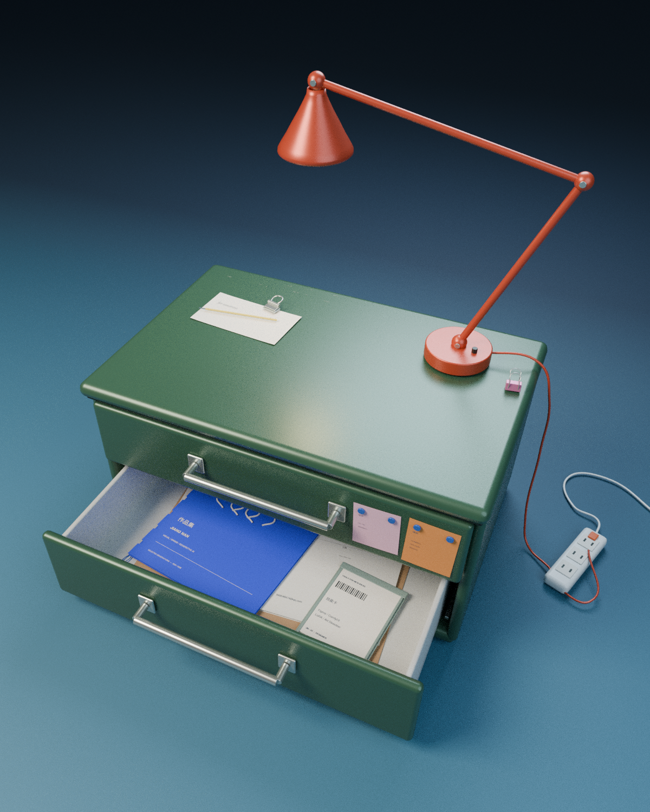

# 江南的个人作品档案柜 · 半开首页版

在上一版微缩办公场景基础上修复便签穿插，并将抽屉内容改为作品集主题的文件档案。

## 下载

- [下载 Blender 模型](portfolio-archive-cabinet.blend?raw=true)
- [查看 1200 × 1500 开屏预览](portfolio-archive-preview.png)

建议使用 Blender 4.3 或更新版本。程序材质及中英文字体已包含在文件内。

## 本次修改

- 两张便签移到银色拉手右侧，改为「留言」；便签与拉手的横向净距约 19.7 mm，纸面与柜体保留微小间隙。
- 抽屉内改为三份可编辑档案：蓝色 **作品集**、米白色 **简历**、灰绿色卡套 **技能卡**。
- 以用户提供的牛皮纸 / 蓝色档案拼贴参考图组织陈设：封面错位旋转、纸张相互叠压、标签少量露出，疏密不均，避免均匀铺满。
- 移除下层抽屉内的曲奇、水瓶、鼠标、扑克牌、笔记本等物件，只保留与作品档案相关的文件及少量回形针。
- 开屏默认半开，减少直接暴露的内容；保留墨绿柜体、橙红台灯和深蓝棚拍氛围。

## 为后续转场保留的控制

1. 选中 `DRAWER 02 · resume portfolio skills`。
2. 在 Object Properties → Custom Properties 中调整 `open_amount`：`0` 全关、`0.50` 半开、`1` 全开。
3. 已提供 `Camera / HOME · half-open archive` 和 `Camera / TOP-DOWN · opening transition` 两台相机。
4. 文件默认使用 HOME 相机、`open_amount=0.50`，没有写死动画关键帧。后续可从此状态制作相机俯视与抽屉打开的转场。
5. 柜内文件随抽屉一起移动，上层留言便签随上层抽屉移动。

## 验证

- 全关、半开、全开控制参数均已检查。
- 文件、外露标签及回形针均在抽屉内壁范围内。
- 便签与拉手保持横向分离；修正了文件夹后部标签伸入后壁的问题。
- 主相机为 4:5 透视构图，预览由 Blender Cycles 实际渲染生成。

文件中的简历与技能卡为可编辑的展示排版，未嵌入真实 PDF 附件。所有文件夹、文字和材质可继续编辑。

