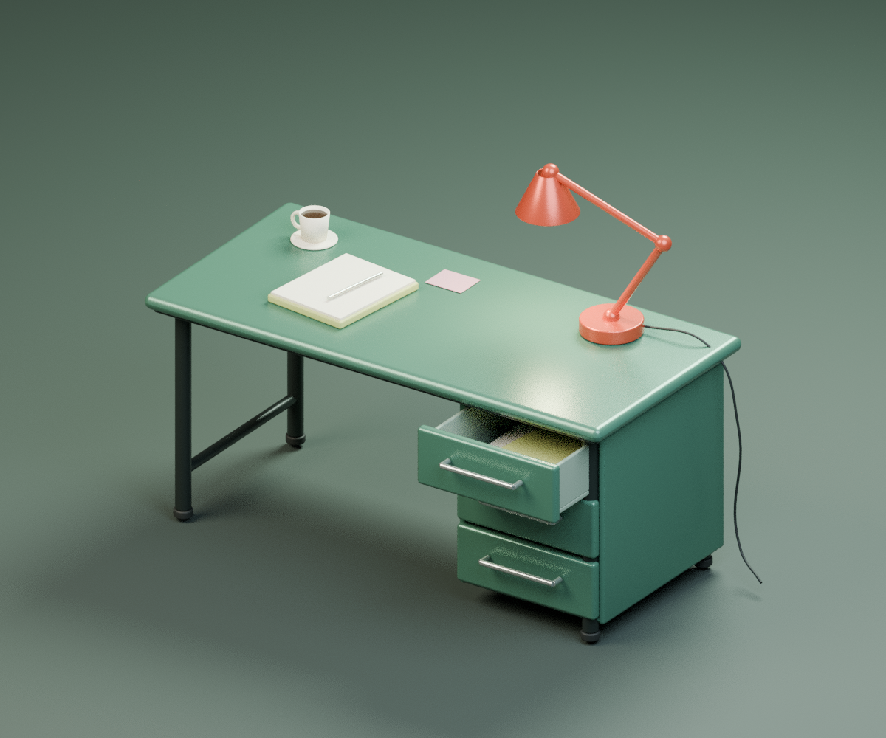

# 绿色设计桌 · Blender 模型

参考绿色抽屉与红色台灯制作的可编辑桌子模型，使用 Blender 4.3.2 创建。

## 下载

- [下载 Blender 模型](green-design-desk.blend?raw=true)
- [查看预览图](green-desk-preview.png)

进入模型文件页面后，点击右上角下载图标（Download raw file），保存为 `.blend` 文件，再用 Blender 打开。

## 模型与操作

- 桌面尺寸约 1.65 × 0.78 m，桌高约 0.76 m。
- 包含三层抽屉、红色台灯、笔记本、杯子和摄影棚灯光及相机。
- 选中名称以 `DRAWER` 开头的控制对象，在 Object Properties → Custom Properties 中修改 `open_amount`（0 为关闭，1 为完全拉开）。
- 全部几何与材质可编辑，无外部贴图依赖。
- 这是基于参考风格制作的桌子模型，并非现有网站交互抽屉模型的导出文件。

