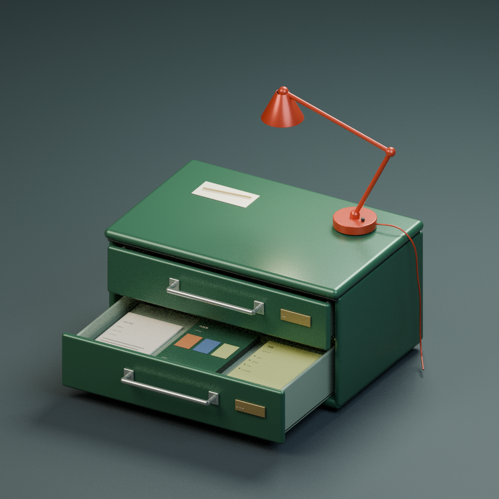

# 江南的设计抽屉 · 绿色档案柜

根据参考图重做的独立两层抽屉柜，包含红色台灯；没有桌面延伸或桌腿。

## 下载

- [下载柜子 Blender 模型](green-archive-cabinet.blend?raw=true)
- [查看模型预览](green-archive-cabinet-preview.png)

下载 .blend 后使用 Blender 4.3 或更新版本打开。中文字体已打包，无需外部贴图。

## 柜内档案

拉开的下层抽屉放置三份独立、可编辑的档案：

1. **简历**：江南、视觉设计师、品牌设计 / AI 创意及联系邮箱。
2. **作品集**：独立封面的项目册，附可编辑的项目缩略色块。
3. **技能**：Figma、ComfyUI、LoRA、Art Direction 技能卡。

上层抽屉内另有备份档案。文档为模型内展示用的可编辑排版，不包含真实 PDF 附件；可在 Blender 内继续替换或完善正文。

## 使用

- 选中名称以 `DRAWER` 开头的控制对象，在 Object Properties → Custom Properties 调整 `open_amount`。
- `0` 为关闭，`1` 为完全拉开；柜内文件随抽屉一起移动。
- 柜体、拉手、台灯、文档及文字均为独立对象，按集合分组。
- `03 · LAMP` 集合可以单独隐藏；`05 · STUDIO` 仅包含渲染地面、灯光及相机。
- 柜体尺寸约 1.30 × 0.86 × 0.69 m（抽屉关闭，不计台灯）。

