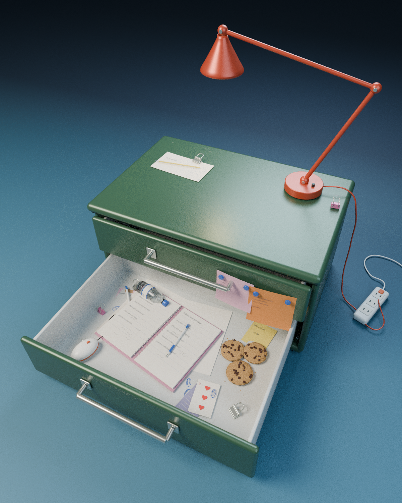

# 生活化微缩办公场景 · 江南的设计抽屉

基于用户上传的 `green-archive-cabinet.blend` 修改，保留墨绿色文件柜主体、两层可开合抽屉和橙红色关节台灯元素。

## 文件

- [下载可编辑 Blender 场景](lived-in-office-cabinet.blend?raw=true)
- [查看 1200 × 1500 最终预览](lived-in-office-preview.png)

用 Blender 4.3 或更新版本打开 `.blend`。模型采用程序材质；字体已打包，无外部贴图或插件依赖。

## 本次调整

- 4:5 竖构图，约 29.4 mm 的近距离透视相机及光学移轴构图；抽屉伸向画面左下方。
- 下层抽屉大幅拉开，浅灰白色金属内壁；笔记本为视觉焦点。
- 打开的粉色封面线圈笔记本、手写纸张、牛皮纸文件夹、蓝白色笔、蓝色回形针、粉色长尾夹、银色票据夹、白色橙边有线鼠标、扑克牌、巧克力曲奇、透明水瓶和零散便签。
- 上层抽屉右侧的粉色 / 橙色便签及蓝色磁铁，柜顶纸张、铅笔及边缘长尾夹。
- 圆弧钟形灯罩、向上伸展的关节灯臂；右侧红色电线、白色插线板与弯曲电线。
- 海军蓝至青蓝色连续棚拍地面，左上主光与弱冷色补光、柔和阴影及轻微景深。
- 微表面涂漆金属、纸张纤维、透明 PET 与水体材质，曲奇及巧克力为可编辑几何体。

## 编辑与渲染

场景共 365 个对象，按柜体、抽屉、台灯、抽屉物件、棚拍环境分组。

1. 选中 `DRAWER 02 · resume portfolio skills`，在 Object Properties → Custom Properties 中调整 `open_amount`（0–1）；下层抽屉最大位移 0.68 m。
2. 上层抽屉使用 `DRAWER 01 · upper archive` 的同名属性。柜内物件及磁铁便签会随对应抽屉移动。
3. 相机 `Camera / close wide-angle vertical` 使用透视投影，焦点为 `Focus / open notebook`，光圈 f/7.1。
4. `F12` 渲染。场景保存为 Cycles、1200 × 1500、160 最大采样、自适应采样；可按设备性能调整。
5. `05 · STUDIO / camera and lights` 集合包含棚拍地面、灯光和相机。

模型保留可编辑的物件、文字、曲线和材质节点，预览由 Blender 实际渲染生成。

