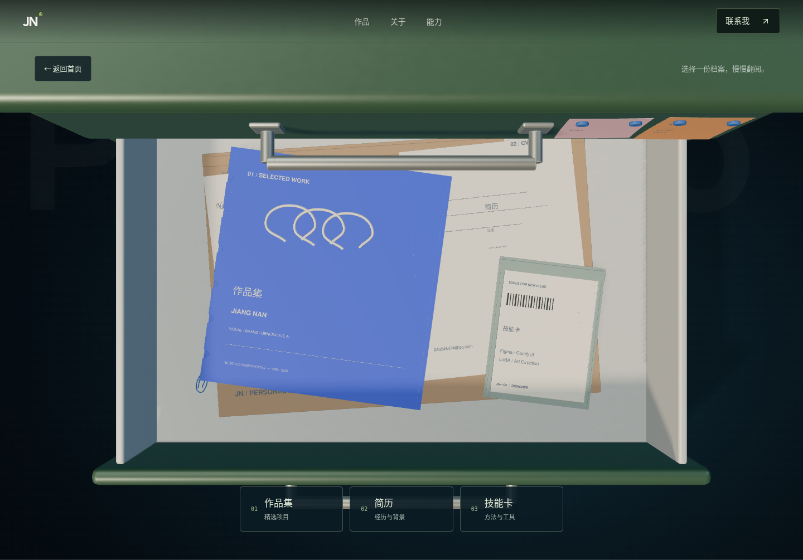

# 设计抽屉交互

托管地址：https://jiangnan-design-drawer-1102-a7d4.nobleatoll1.chatgpt.site

站点使用账号访问控制。

- 点击拉手或「打开设计抽屉」：GSAP 驱动相机转为俯视，抽屉完全打开。
- 点击 3D 文件夹或底部按钮：查看作品集、简历与技能卡。
- 点击留言便签：打开联系入口。
- 简历面板支持 PDF 下载、打印；弹层支持 Escape 与关闭按钮。
- 点击「返回首页」：关闭抽屉并恢复确认过的首屏构图。
- 支持减少动态效果设置；3D 加载失败时保留预览与原有页面导航。

本机预览：运行 `npm ci`，再运行 `npm run dev`，打开终端显示的本机网址。

